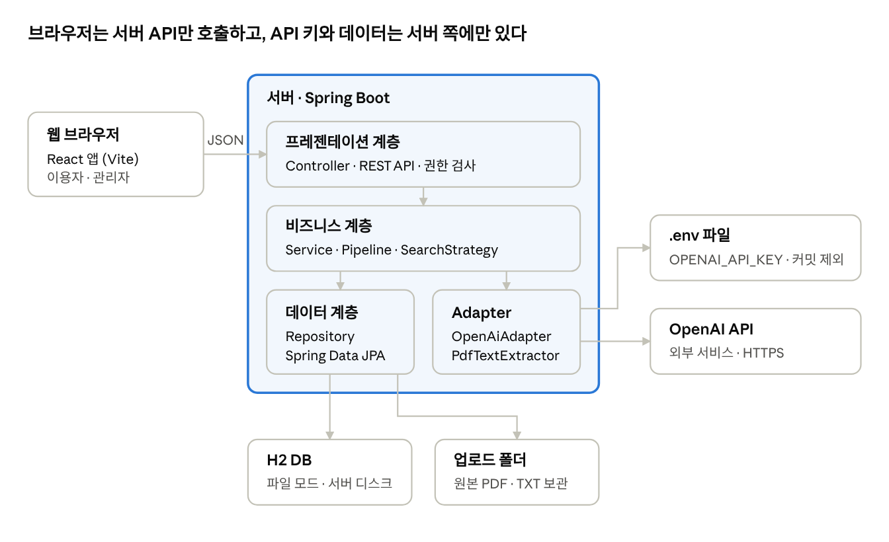
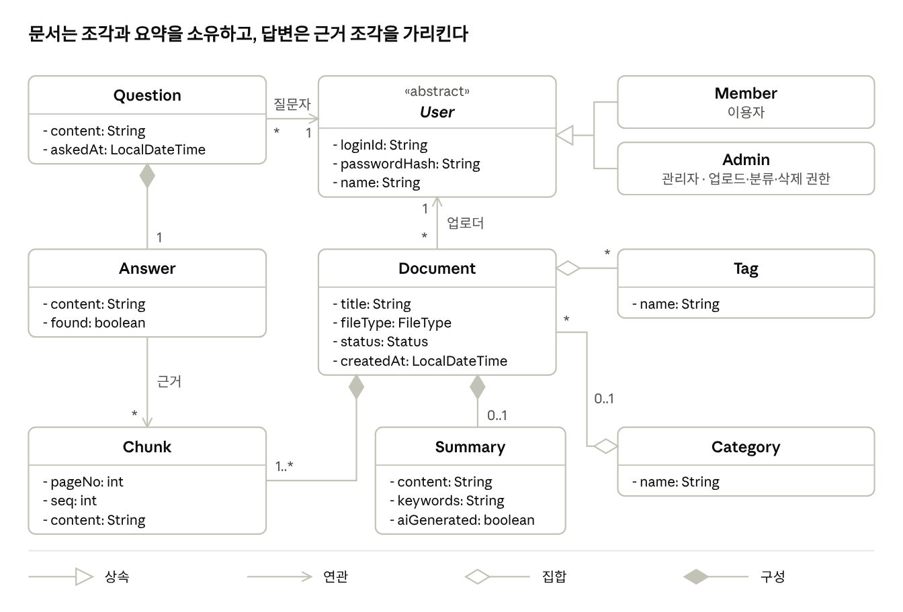
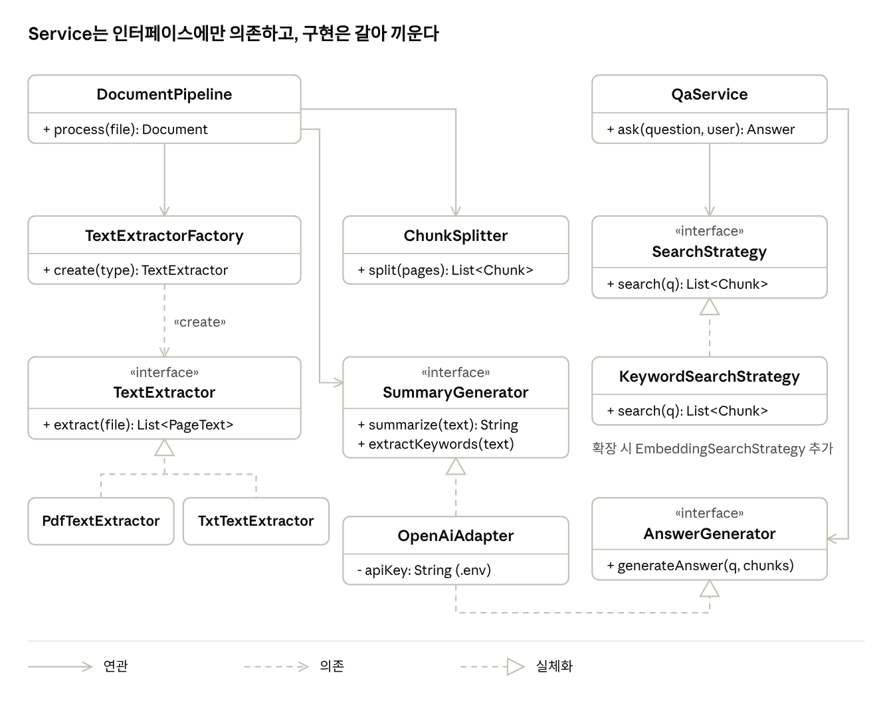
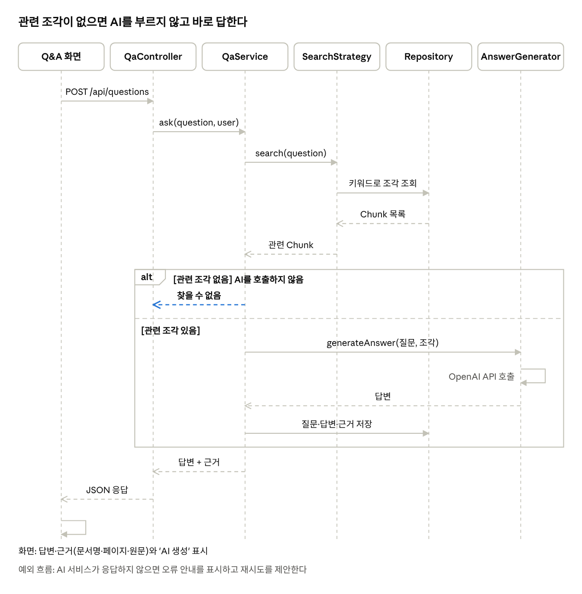
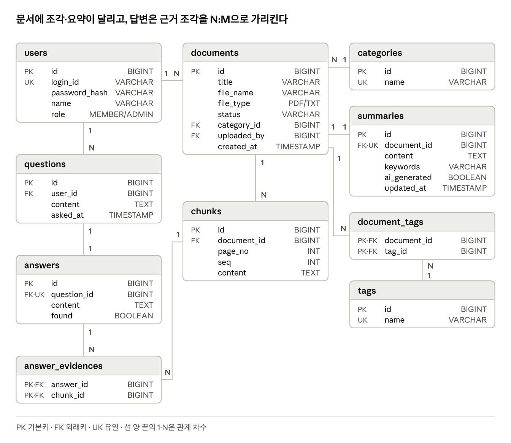
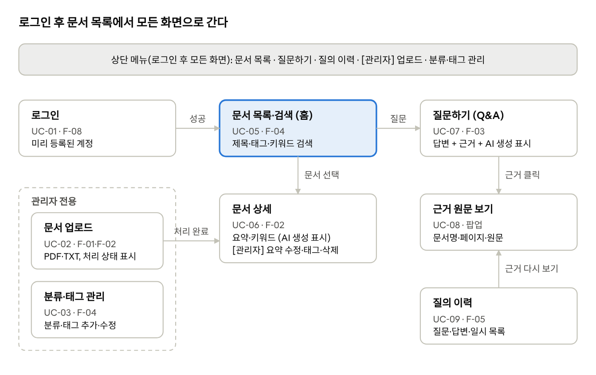

# 시스템 설계서 — AKAI

개정 2026-11-24: 확장 기능 F-06·F-07·F-09\~F-11의 설계를 11절에 반영했다.

## 1. 아키텍처 스타일

AKAI는 서비스 전체를 **클라이언트-서버 + 3계층**으로, 문서 처리 부분을 \*\*데이터 흐름(파이프-필터)\*\*으로 설계한다. 아래 4단계로 결정했다.

**1단계 · 요구사항에서 구조의 단서 찾기**

- 이용자와 관리자가 웹 브라우저로 접속하고, 데이터와 API 키는 서버 한 곳에서 관리해야 한다(F-08, NF-03).

- 문서 처리는 업로드 → 텍스트 추출 → 조각 분할 → 요약·키워드 생성 → 저장이 정해진 순서로 이어진다(F-01, F-02).

- 검색 방식(키워드 → 임베딩), 지원 파일 형식, AI 제공자는 프로젝트 중에 바뀔 수 있다(F-06·F-10, 확장 기능).

**2단계 · 핵심 품질 속성 정하기**

정확성(근거 기반 답변), 성능(문서 처리·응답 시간), 보안성(API 키·권한)을 핵심 품질 속성으로 정했다. 목표와 검증 방법은 2절에 있다. 바뀔 부분이 분명하므로 변경 용이성도 함께 고려했다.

**3단계 · 후보 스타일 비교**

| 후보 스타일              | 이 시스템에 맞는 점                                                  | 맞지 않는 점                                                     | 판단             |
|--------------------------|----------------------------------------------------------------------|------------------------------------------------------------------|------------------|
| 클라이언트-서버          | 브라우저(React)와 서버(Spring Boot)를 나눠 키·데이터를 서버에만 둔다 | 서버 내부 구조는 정해 주지 않는다                                | 채택 (전체)      |
| 계층                     | Controller·Service·Repository로 책임을 나눠 테스트와 교체가 쉽다     | 단순 조회도 계층을 거쳐 코드가 늘어난다                          | 채택 (서버 내부) |
| 데이터 흐름(파이프-필터) | 문서 처리 단계를 독립 클래스로 나눠 단계별 교체·테스트가 쉽다        | 대화형 기능(Q&A)에는 맞지 않는다                                 | 채택 (문서 처리) |
| MVC                      | 화면·로직 분리                                                       | 화면은 React가 맡고 서버는 JSON API만 제공해 서버 쪽 View가 없다 | 계층 구조로 대체 |
| 데이터 중심형            | 문서·조각을 DB 한 곳에서 공유                                        | 여러 독립 프로그램이 저장소를 공유하는 구조가 아니다             | 미채택           |

**4단계 · 선정과 품질 속성 반영**

| 품질 속성   | 구조에서 반영한 방법                                                                                                      |
|-------------|---------------------------------------------------------------------------------------------------------------------------|
| 정확성      | 검색(코드)과 답변 생성(AI)을 다른 클래스로 나누고, Service가 검색된 조각만 AI에 넘긴다. 조각이 없으면 AI를 부르지 않는다. |
| 성능        | 파이프라인이 업로드 때 한 번만 요약을 만들어 저장하고, 조회는 저장된 값을 읽는다.                                         |
| 보안성      | API 키와 OpenAI 호출은 서버의 Adapter 안에만 있고, 권한 검사는 서버 계층에서 한다.                                        |
| 변경 용이성 | 바뀔 부분(파일 형식, 검색 방식, AI 제공자)을 인터페이스 뒤에 두어 새 구현만 추가한다(5절).                                |

## 2. 핵심 품질 속성

정확성·성능·보안성 3개를 정량 목표로 관리한다. 목표는 요구사항 정의서의 NF-01\~NF-03과 같다.

| 품질 속성      | 목표                                                                                  | 달성 방법                                                                                                                                                   | 검증 방법                                                                                                              |
|----------------|---------------------------------------------------------------------------------------|-------------------------------------------------------------------------------------------------------------------------------------------------------------|------------------------------------------------------------------------------------------------------------------------|
| 정확성 (NF-01) | 평가 질문 20개 중 정답률 90% 이상, 근거 표시율 100%, 문서에 없는 질문 거절률 90% 이상 | 검색된 조각만 프롬프트에 넣고, 조각이 없으면 AI를 호출하지 않고 "문서에서 찾을 수 없음"을 반환한다. 답변마다 근거 조각(문서명·페이지·원문)을 저장·표시한다. | 정답이 정해진 평가 질문 세트를 자동 채점 스크립트로 실행해 세 지표를 측정한다(WBS 4.4, 5.2).                           |
| 성능 (NF-02)   | 10페이지 PDF 처리 30초 이내, 질문 응답 5초 이내                                       | 조각 단위로 저장하고 요약은 업로드 때 한 번만 만든다. 질문에는 관련 조각만 보내 프롬프트를 짧게 유지한다.                                                   | 파이프라인 단계별·질문별 처리 시간을 로그로 남기고, 10쪽 시연 문서(학사운영규정)로 측정한다.                           |
| 보안성 (NF-03) | API 키 노출 0건, 업로드·삭제·분류 수정은 관리자만 가능                                | 키는 서버의 .env에만 두고 .gitignore로 커밋을 막는다. 관리자 API는 서버에서 역할을 검사한다.                                                                | 저장소·프런트 빌드 결과에서 키 문자열을 검색하고, 이용자 계정으로 관리자 API를 호출하는 권한 테스트 케이스를 실행한다. |

## 3. 4+1 관점

5개 관점을 모두 표현했다. 물리·개발 관점은 이 절에, 나머지는 표의 위치에 있다.

| 관점         | 보여 주는 것                     | 표현 위치                                                                            |
|--------------|----------------------------------|--------------------------------------------------------------------------------------|
| 시나리오(+1) | 사용자가 시스템으로 하는 일      | 요구사항 정의서의 유스케이스 다이어그램(UC-01\~UC-12), 핵심 시나리오는 UC-07 질문하기 |
| 논리         | 클래스와 그 관계                 | 4절 클래스 다이어그램                                                                |
| 프로세스     | 실행 중 객체들이 주고받는 메시지 | 7절 Q&A 시퀀스 다이어그램                                                            |
| 개발         | 소스 코드의 패키지 구조          | 아래 패키지 구조                                                                     |
| 물리         | 실행 환경과 배치                 | 아래 배치 다이어그램                                                                 |

**개발 관점 · 패키지 구조**

계층(controller·service·repository)과 바뀔 부분(extractor·search·ai)을 패키지로 나눴다. 상위 패키지는 하위 패키지의 인터페이스에만 의존한다.

```text
backend/src/main/java/com/tadak/akai/
├── controller/   AuthController, DocumentController, QaController, TagController, AdminController, ComparisonController
├── service/      DocumentService, QaService, TagService, ComparisonService, SearchComparisonService, StatisticsService
├── pipeline/     DocumentPipeline, ChunkSplitter
├── extractor/    TextExtractor, TextExtractorFactory, PdfTextExtractor, TxtTextExtractor
├── search/       SearchStrategy, KeywordSearchStrategy, EmbeddingSearchStrategy, ScoredChunk
├── ai/           SummaryGenerator, AnswerGenerator, EmbeddingGenerator, ComparisonGenerator, ComparisonSource, OpenAiAdapter
├── domain/       User, Member, Admin, Document, Chunk, Summary, Category, Tag, Question, Answer
├── repository/   DocumentRepository, ChunkRepository, QuestionRepository, UserRepository, TagRepository, CategoryRepository
└── config/       SecurityConfig, AppConfig

frontend/src/
├── pages/        LoginPage, DocumentListPage, DocumentDetailPage, QaPage, HistoryPage, UploadPage, TagManagePage, ComparePage, DashboardPage, SearchComparePage
├── components/   공통 컴포넌트(왼쪽 메뉴, 근거 카드, AI 생성 배지)
└── api/          서버 API 호출 함수
```

**물리 관점 · 배치**



배치 다이어그램 · 브라우저, Spring Boot 서버, 외부 자원

브라우저는 JSON API만 호출한다. API 키(.env)와 OpenAI 호출은 서버의 Adapter 안에만 있고, DB와 업로드 원본은 서버 디스크에 둔다.

## 4. 클래스 다이어그램

클래스 다이어그램은 도메인 모델(4.1)과 처리·서비스 클래스(4.2) 두 장으로 나눴고, 관계 6종을 모두 구분해 표기했다.

| 관계         | UML 표기                    | 이 설계의 예                                                                       |
|--------------|-----------------------------|------------------------------------------------------------------------------------|
| 상속(일반화) | 실선 + 빈 삼각형            | Member, Admin → User                                                               |
| 실체화       | 점선 + 빈 삼각형            | PdfTextExtractor → TextExtractor, OpenAiAdapter → SummaryGenerator·AnswerGenerator |
| 연관         | 실선 + 열린 화살표          | Question → User(질문자), Answer → Chunk(근거), QaService → SearchStrategy          |
| 집합         | 실선 + 빈 마름모(전체 쪽)   | Document ◇ Tag, Category ◇ Document (부분이 따로 존재한다)                         |
| 구성         | 실선 + 채운 마름모(전체 쪽) | Document ◆ Chunk·Summary, Question ◆ Answer (전체가 삭제되면 함께 삭제)            |
| 의존         | 점선 + 열린 화살표          | TextExtractorFactory → TextExtractor («create», 생성해 돌려주기만 한다)            |

### 4.1 도메인 모델



도메인 클래스 다이어그램 · 클래스 10개, 상속·연관·집합·구성

문서를 지우면 조각·요약도 함께 지워지고(구성), 태그·분류는 남는다(집합). 답변은 근거 조각을 가리켜 문서명·페이지·원문을 표시한다.

### 4.2 처리·서비스 클래스



처리·서비스 클래스 다이어그램 · 연관·의존·실체화

DocumentPipeline은 추출 → 분할 → 요약 순서만 정하고, QaService는 검색·답변 인터페이스만 안다. OpenAiAdapter 하나가 요약과 답변 인터페이스를 모두 구현한다.

## 5. 디자인 패턴 적용 계획

"무엇이 자주 바뀌는가"를 기준으로 변경 지점 3곳에 Factory Method, Strategy, Adapter를 적용한다(3인 팀 기준 2개 이상).

| 패턴           | 적용 지점                                                | 자주 바뀌는 것                         | 적용 전                                                                                                 | 적용 후                                                                                                                                                             |
|----------------|----------------------------------------------------------|----------------------------------------|---------------------------------------------------------------------------------------------------------|---------------------------------------------------------------------------------------------------------------------------------------------------------------------|
| Factory Method | 파일 형식별 텍스트 추출기 생성 (TextExtractorFactory)    | 지원 파일 형식(PDF, TXT, 이후 DOCX 등) | DocumentService가 확장자를 if-else로 판단하고 추출 코드를 직접 가진다. 형식을 추가하면 서비스를 고친다. | 팩토리가 확장자에 맞는 TextExtractor 구현을 돌려준다. 형식 추가는 구현 클래스 1개와 팩토리 등록 1줄이고, 지원하지 않는 형식은 팩토리가 거부한다(F-01).              |
| Strategy       | 질문과 관련된 조각 검색 (SearchStrategy)                 | 검색 방식(키워드 → 임베딩)             | QaService 안에 키워드 검색 코드가 있어, 임베딩을 넣으려면 Q&A 로직을 고친다.                            | QaService는 SearchStrategy만 알고, MVP는 KeywordSearchStrategy, 확장 때 EmbeddingSearchStrategy를 설정으로 교체한다(F-06, F-10). 기본값은 평가 결과에 따라 keyword. |
| Adapter        | OpenAI API·PDFBox 연결 (OpenAiAdapter, PdfTextExtractor) | AI 제공자·모델, PDF 라이브러리         | 서비스가 OpenAI 요청 형식과 PDFBox API를 직접 호출한다. 제공자가 바뀌면 호출하는 곳을 모두 고친다.      | 우리 인터페이스(SummaryGenerator, AnswerGenerator, TextExtractor)를 정하고, Adapter가 외부 API를 그 형태로 바꾼다. API 키도 Adapter 안에서만 읽는다.                |

**적용 전후 비교 예시 · Strategy**

```java
// 적용 전: 검색 방식이 QaService에 박혀 있다
public Answer ask(String question) {
    List<Chunk> chunks = chunkRepository.findByContentContaining(question);
    // 임베딩 검색을 넣으려면 여기에 if-else가 늘어난다
    ...
}

// 적용 후: QaService는 인터페이스만 알고, 구현은 주입받는다
public interface SearchStrategy {
    List<Chunk> search(String question);
}

public class QaService {
    private final SearchStrategy searchStrategy;

    public Answer ask(String question) {
        List<Chunk> chunks = searchStrategy.search(question);
        ...
    }
}
```

## 6. SOLID 체크리스트

초기 설계에서 위반 의심 지점 3건(SRP·DIP·ISP)을 찾아 고쳤고, 고친 결과가 4절 클래스 다이어그램이다.

| 원칙                  | 점검 질문                                           | 점검 결과    | 위반 의심 지점과 개선 내용                                                                                                                                                                             |
|-----------------------|-----------------------------------------------------|--------------|--------------------------------------------------------------------------------------------------------------------------------------------------------------------------------------------------------|
| SRP (단일 책임)       | 클래스가 바뀌는 이유가 하나뿐인가?                  | 개선 후 준수 | 초안의 DocumentService가 파일 저장, 텍스트 추출, 분할, 요약 요청, DB 저장을 모두 맡았다. → 추출(TextExtractor), 분할(ChunkSplitter), 요약(SummaryGenerator)을 나누고 DocumentPipeline이 순서만 정한다. |
| OCP (개방-폐쇄)       | 기능을 추가할 때 기존 코드를 고치지 않는가?         | 준수         | 파일 형식과 검색 방식은 새 구현 클래스를 추가해 늘린다(5절 Factory Method·Strategy).                                                                                                                   |
| LSP (리스코프 치환)   | 하위 타입이 상위 타입 자리에서 그대로 동작하는가?   | 준수         | Admin은 User로서 할 수 있는 일을 모두 하고 권한만 더한다. TextExtractor 구현은 모두 "페이지별 텍스트 목록"을 돌려주고, TXT는 전체를 1페이지로 본다.                                                    |
| ISP (인터페이스 분리) | 클라이언트가 쓰지 않는 메서드에 의존하지 않는가?    | 개선 후 준수 | 초안의 AiClient는 요약·키워드·답변 메서드를 모두 가져, Q&A 쪽이 쓰지 않는 요약 메서드에도 의존했다. → SummaryGenerator와 AnswerGenerator로 나누고 OpenAiAdapter가 둘을 모두 구현한다.                  |
| DIP (의존 역전)       | 상위 모듈이 구체 클래스가 아닌 추상화에 의존하는가? | 개선 후 준수 | 초안의 QaService가 OpenAI 요청 코드를 직접 가졌다. → AnswerGenerator 인터페이스에 의존하고, 구현은 생성자로 주입받는다.                                                                                |

## 7. Q&A 시퀀스 다이어그램

핵심 유스케이스 UC-07 질문하기의 흐름이다. 검색은 코드가 하고, AI는 검색된 조각이 있을 때만 호출한다.



UC-07 질문하기 시퀀스 다이어그램 · 객체 6개, alt 2개 분기

관련 조각이 없으면 QaService가 AI를 부르지 않고 "문서에서 찾을 수 없음"을 돌려준다. 이 분기가 정확성 목표(거절률 90% 이상)를 달성하는 장치다.

## 8. ERD

H2(파일 모드)에 테이블 10개를 둔다. 주제 안내서의 주요 데이터(Document, Chunk, Summary, Tag, Question, Answer)를 모두 테이블로 만들고, 다대다 관계 2개는 연결 테이블로 풀었다.



ERD · 테이블 10개

- document_tags: 문서와 태그의 N:M을 푼다(F-04).

- answer_evidences: 답변 하나가 여러 근거 조각을 가리킨다. 근거의 문서명·페이지는 chunks → documents를 따라 얻는다(F-03, F-05).

- answers.found: "문서에서 찾을 수 없음" 응답이면 false로, 거절률 측정에 쓴다.

- users.role: 상속(Member·Admin)을 단일 테이블 + 구분 컬럼으로 저장한다.

- documents.uploaded_by: 업로드한 관리자를 기록해 "내가 올린 문서" 필터를 적은 비용으로 만들 수 있게 했다.

- 확장 기능(11절)을 위해 chunks.embedding, questions.response_millis 컬럼을 추가했다. 테이블 수는 그대로 10개다.

## 9. 화면 흐름도

필수 기능 화면 8개가 유스케이스 UC-01\~UC-09에 하나씩 대응한다. 11/24에 추가한 화면 3개(문서 비교·품질 지표·검색 방식 비교)는 UC-10\~UC-12에 대응한다(11절). 로그인 후 모든 화면은 왼쪽 메뉴로 서로 이동한다(좁은 화면에서는 위쪽 가로줄로 접힌다).



화면 흐름도 · 화면 8개

관리자 전용 화면과 버튼은 이용자에게 보이지 않지만, 권한은 화면이 아니라 서버에서 다시 검사한다(NF-03).

## 10. 프로젝트 골격과 실행 구조

설계서의 구조를 저장소 골격으로 옮겨 두었다. 서버는 3절의 패키지 구조와 같게, 클라이언트는 9절의 화면 단위로 만들었고, 기능 로직은 F-ID 단위로 채워 간다. 3절 물리 관점의 배치는 실제로 아래 프로세스 둘로 실행한다.

**저장소 골격**

```text
akai/
├── backend/    Spring Boot 서버 (3절 패키지 구조)
├── frontend/   React(Vite) 클라이언트 (pages · components · api)
├── db/         schema.sql, sample-data.sql (8절 ERD)
├── eval/       평가 질문 세트, 자동 채점 스크립트
└── docs/       기획서, 요구사항 정의서, WBS, 설계서, AI 활용 로그
```

**실행 구조**

| 구성 요소    | 위치·포트(실행 명령)                                    | 역할                                                                                                                          |
|--------------|---------------------------------------------------------|-------------------------------------------------------------------------------------------------------------------------------|
| 프런트엔드   | frontend/, React + Vite, localhost:5173 (npm run dev)   | 화면을 보여 주고 /api 요청을 서버로 보낸다. Vite 개발 서버가 /api를 8080으로 넘긴다(프록시).                                  |
| 백엔드       | backend/, Spring Boot, localhost:8080 (gradlew bootRun) | Controller → Service → Repository 3계층. 업로드 처리, AI 호출, 권한 검사를 맡는다.                                            |
| 데이터베이스 | H2 파일 모드, backend/data/akai.mv.db                   | 서버 프로세스 안에서 열려 별도 DB 서버가 없다. 테이블은 JPA가 만들고 db/schema.sql은 확인용이다. 확인은 /h2-console에서 한다. |
| 업로드 원본  | backend/uploads/                                        | 업로드한 PDF·TXT 원본을 서버 디스크에 둔다(저장소에는 올리지 않는다).                                                         |
| 외부 서비스  | OpenAI API                                              | 요약·답변 생성. 키는 backend/.env의 OPENAI_API_KEY를 서버만 읽고 커밋하지 않는다.                                             |

요청은 브라우저 → Vite 프록시(/api) → Spring Boot → H2 순서로 흐르고, 요약과 답변이 필요할 때만 서버가 OpenAI를 호출한다. 필요한 것은 JDK 17 이상과 Node.js 18 이상이며, 자세한 실행 방법은 저장소 README에 있다.

## 11. 확장 기능 설계 (F-06·F-07·F-09\~F-11)

11/24에 확장(선택) 기능 F-06·F-07과 요구사항 정의서에 추가한 F-09\~F-11을 설계에 반영했다. 필수 기능(F-01\~F-05, F-08)의 구조는 바꾸지 않고, 4절의 인터페이스 뒤에 새 구현을 더하는 방식(OCP)으로 만들었다. 4.2 클래스 다이어그램과 9절 화면 흐름도는 필수 기능 기준이며, 확장 클래스와 화면은 11.7 표로 정리했다.

### 11.1 확장 기능 한눈에 보기

| ID   | 기능                  | 사용자 | 구현 지점                                                                                            | 적용 원칙·패턴              | 관련 품질 속성 |
|------|-----------------------|--------|------------------------------------------------------------------------------------------------------|-----------------------------|----------------|
| F-06 | 임베딩 기반 의미 검색 | 이용자 | EmbeddingSearchStrategy, EmbeddingGenerator(인터페이스, OpenAiAdapter가 구현), chunks.embedding 컬럼 | Strategy, Adapter, OCP, ISP | 정확성         |
| F-07 | 여러 문서 비교 요약   | 이용자 | ComparisonController, ComparisonService, ComparisonGenerator(인터페이스, OpenAiAdapter가 구현)       | Adapter, ISP                | 정확성         |
| F-09 | 품질 지표 대시보드    | 관리자 | AdminController, StatisticsService, questions.response_millis 컬럼                                   | SRP                         | 정확성, 성능   |
| F-10 | 검색 방식 비교        | 관리자 | AdminController, SearchComparisonService                                                             | Strategy                    | 변경 용이성    |
| F-11 | 근거 하이라이트       | 이용자 | 프런트 utils/highlight.js, Highlighted 컴포넌트                                                      | SRP                         | 사용성         |

### 11.2 F-06 임베딩 기반 의미 검색

- 질문과 조각을 임베딩(숫자 벡터)으로 바꿔 코사인 유사도가 높은 조각을 찾는다. "학점"과 "등급"처럼 키워드가 달라도 뜻이 비슷하면 찾는다. QaService는 SearchStrategy만 알기 때문에 수정하지 않는다(5절 Strategy, OCP).

- EmbeddingGenerator 인터페이스가 텍스트를 벡터로 바꾸고 OpenAiAdapter가 구현한다. 요약·답변·비교와 용도가 달라 별도 인터페이스로 분리했다(ISP). API 키는 이전처럼 Adapter 안에서만 읽는다.

- 조각 임베딩은 업로드 때가 아니라 처음 검색할 때 계산해 chunks.embedding에 저장한다. 문서 처리 파이프라인(추출 → 분할 → 요약)은 그대로이고, 업로드 처리 시간(NF-02)에 영향을 주지 않는다.

- 기준 유사도(app.search.embedding.min-similarity, 현재 0.35)보다 낮은 조각만 있으면 빈 목록을 돌려주고, QaService는 기존대로 AI를 부르지 않고 "문서에서 찾을 수 없음"으로 답한다. 최대 3개를 돌려준다. 정확성 규칙은 그대로다.

- 임베딩 API가 응답하지 않으면 키워드 검색으로 대신해 질문하기가 멈추지 않게 한다.

- 검색 방식은 설정 app.search.strategy(keyword 또는 embedding)로 고른다. 바꿔도 QaService는 그대로다. 임베딩 모델은 openai.embedding-model로 정하고 비우면 text-embedding-3-small을 쓴다.

- 기본값은 keyword다(PR \#20). 평가 질문 24개로 측정한 결과 키워드 검색은 정답률 100%(17/17), 임베딩 검색은 94.1%(16/17)였고, 임베딩 기준값 0.35가 답 없음 질문 7개 중 5개를 걸러내지 못했으며(D-10) 서버 시작 후 첫 질문이 5.76초로 5초를 넘었다(D-11). 임베딩 검색은 F-10 검색 방식 비교 화면에서 확인한다. 자세한 내용은 AI 활용 검증 보고서에 있다(평가는 PR \#21 이전 코드 기준이다). 이후 PR \#21로 키워드 검색은 키워드의 절반 이상, 키워드가 2개 이상이면 최소 2개가 들어 있는 조각만 관련 조각으로 본다.

- 검증: 평가 질문 24개와 표현을 바꾼 보조 질문 7개로 두 방식을 비교했다(NF-01). 보조 질문은 두 방식 모두 정답률 42.9%(3/7)였고, 기준 유사도 0.35는 답 있음·답 없음 질문을 가르지 못했다(D-10).

### 11.3 F-07 여러 문서 비교 요약

- 이용자가 문서 목록에서 2\~5개를 선택하면 공통점과 차이점을 요약한다. 로그인한 사용자 모두 쓸 수 있다.

- API: POST /api/comparisons(본문: 문서 id 목록). 2개 미만이거나 5개를 넘으면 오류 안내를 돌려준다.

- 입력: 업로드 때 저장한 요약을 다시 쓰고(요약 재생성 없음), 요약이 없는 문서만 본문 앞 3,000자를 AI에 보낸다.

- ComparisonGenerator 인터페이스(입력은 ComparisonSource)를 따로 두고 OpenAiAdapter가 구현한다(ISP). ComparisonService는 문서 조회·검증·호출만 맡는다(SRP).

- 결과에는 "AI 생성"을 표시하고, 비교 결과는 저장하지 않고 바로 보여 준다. AI가 응답하지 않으면 UC-07 예외 흐름처럼 오류 안내를 보여 준다.

### 11.4 F-09 품질 지표 대시보드

관리자가 품질 목표(NF-01·NF-02) 관련 지표를 한 화면에서 확인한다. 모든 값은 저장된 데이터를 코드가 집계해 계산하고 AI는 쓰지 않는다.

| 지표                                          | 계산 방법                                 | 관련 요구사항         |
|-----------------------------------------------|-------------------------------------------|-----------------------|
| 문서·조각·임베딩 조각 수, 질문 수             | DB 집계                                   | 현황 파악             |
| "문서에서 찾을 수 없음" 수와 비율             | 전체 질문 중 answers.found가 false인 비율 | NF-01 거절 동작 확인  |
| 평균 응답 시간                                | questions.response_millis 평균            | NF-02 (질문 응답 5초) |
| 5초 이내 응답 비율                            | response_millis가 5초 이하인 질문의 비율  | NF-02                 |
| 근거로 많이 쓰인 문서, 최근 찾을 수 없음 질문 | answer_evidences 집계, 최근 질문 목록     | 검색 품질 점검        |

- API: GET /api/admin/statistics. /api/admin/\*\*는 SecurityConfig에서 관리자만 허용한다(NF-03).

- questions.response_millis 컬럼은 QaService가 검색부터 답변까지 걸린 시간(ms)을 기록한다.

- 이 화면의 거절 비율은 실제 질문 이력 기준이다. 평가 질문의 정답률·거절률은 eval/ 자동 채점으로 따로 측정한다(WBS 4.4).

### 11.5 F-10 검색 방식 비교

- 관리자가 질문을 입력하면 키워드 검색과 임베딩 검색 결과를 나란히 보여 준다. 각 결과에는 문서명·쪽·원문·점수·관련 여부가 있고, 방식별 소요 시간과 오류 안내(검색이 실패한 경우)도 함께 보여 준다. 키워드 검색은 질문에서 뽑은 키워드도 보여 준다.

- API: POST /api/admin/search-comparison. 관리자 전용이다. AI 답변은 만들지 않아 검색 품질만 비교한다.

- SearchComparisonService가 두 검색 방식을 각각 호출한다. 검색은 SearchStrategy 구현을 거치므로 설정으로 고른 기본 방식과 관계없이 둘을 모두 볼 수 있다.

- 용도: 평가 질문으로 어느 방식이 근거 조각을 더 잘 찾는지 확인해 기준 유사도 조정과 NF-01 개선의 근거로 쓴다.

### 11.6 F-11 근거 하이라이트

- 근거 카드와 근거 원문 팝업(UC-08)에서 질문과 관련된 단어를 강조해 답의 위치를 쉽게 찾게 한다.

- 프런트 utils/highlight.js가 서버 키워드 검색(KeywordSearchStrategy)과 같은 방식으로 조사·어미를 떼고 불용어를 뺀 단어를 뽑아 원문에서 찾고, Highlighted 컴포넌트가 해당 글자를 강조해 그린다. 서버 API는 바꾸지 않았다.

- AI가 답변에 쓴 문장을 강조하는 방식은 AI 출력에 기대야 해 정확성을 보증할 수 없어 쓰지 않았다. 질문 단어와의 일치만 강조한다.

### 11.7 변경 영향 정리

| 항목         | 변경 내용                                                                                                                                                                                                                                                                                                              |
|--------------|------------------------------------------------------------------------------------------------------------------------------------------------------------------------------------------------------------------------------------------------------------------------------------------------------------------------|
| ERD          | 테이블 수는 10개 그대로다. 컬럼 2개를 추가했다: chunks.embedding(임베딩, 처음 검색할 때 계산), questions.response_millis(응답 시간 ms). db/schema.sql에 반영했다.                                                                                                                                                      |
| API          | 신규 3개: POST /api/comparisons(F-07), GET /api/admin/statistics(F-09), POST /api/admin/search-comparison(F-10). F-06은 설정과 내부 구현만, F-11은 화면만 바뀐다.                                                                                                                                                      |
| 화면         | 8개 → 11개. 문서 비교(F-07), 품질 지표(F-09), 검색 방식 비교(F-10)가 추가되었다. F-11은 근거 카드·원문 팝업 안에서 처리한다.                                                                                                                                                                                           |
| 유스케이스   | 문서 비교(F-07), 품질 지표 조회(F-09), 검색 방식 비교(F-10)를 UC-10\~UC-12로 추가했다(요구사항 정의서 3절과 같다). F-06은 UC-07의 검색 단계, F-11은 UC-08에 포함된다.                                                                                                                                                   |
| 클래스       | 신규: EmbeddingSearchStrategy, ScoredChunk, EmbeddingGenerator, ComparisonGenerator, ComparisonSource, ComparisonService, StatisticsService, SearchComparisonService, AdminController, ComparisonController. OpenAiAdapter가 EmbeddingGenerator·ComparisonGenerator도 구현한다. QaService는 응답 시간 기록만 추가했다. |
| SOLID        | OCP: 새 검색 방식은 새 구현으로 추가한다. ISP: 임베딩·비교를 별도 인터페이스로 둔다. DIP: 서비스는 인터페이스에만 의존한다.                                                                                                                                                                                            |
| 품질 속성    | 정확성: "근거 없으면 AI 미호출" 규칙을 유지하고, F-09로 확인하고 F-10으로 비교한다. 성능: 임베딩은 처음 검색할 때 계산하므로 첫 검색이 느릴 수 있다(측정 5.76초, D-11). 기본 검색 방식을 keyword로 두어 NF-02를 지킨다. 보안성: 신규 관리자 API 2개는 서버에서 권한을 검사한다(NF-03).                                 |
| AI 사용 규칙 | 새로 AI를 쓰는 기능은 F-06(벡터 생성)과 F-07(비교 요약)이며, F-07 결과에는 "AI 생성"을 표시한다. F-09\~F-11은 AI 없이 코드가 계산한다.                                                                                                                                                                                  |
