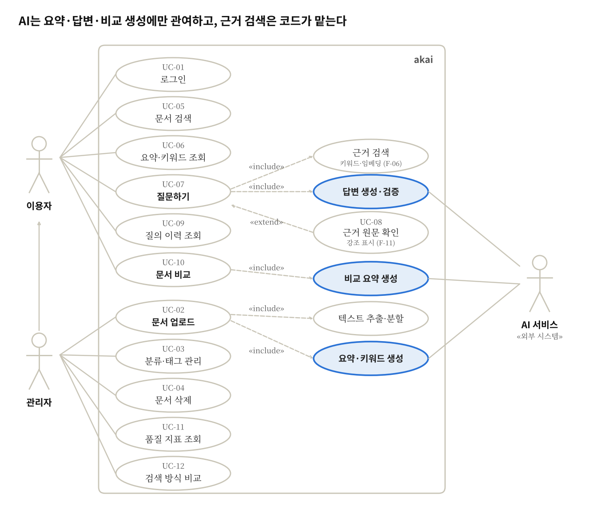

# 요구사항 정의서

## 1. 기능 요구사항

| ID   | 기능명                 | 설명                                                                                                                                                  | 사용자         | 우선순위 |
|------|------------------------|-------------------------------------------------------------------------------------------------------------------------------------------------------|----------------|----------|
| F-01 | 문서 업로드·추출·분할  | PDF·TXT를 업로드하면 텍스트를 추출하고, 페이지·문단 단위 조각(Chunk)으로 나눠 DB에 저장한다. 지원하지 않는 형식은 거부한다.                           | 관리자         | 필수     |
| F-02 | AI 요약·키워드 생성    | 문서별 요약(5문장 이내)과 핵심 키워드 5개를 생성해 저장한다. 화면에 "AI 생성" 표시를 붙이고, 관리자가 수정할 수 있다.                                 | 관리자         | 필수     |
| F-03 | 근거 기반 Q&A          | 질문과 관련된 조각만 검색해 답변을 생성하고, 근거 문서명·페이지·원문을 함께 표시한다. 근거가 없으면 "문서에서 찾을 수 없음"으로 응답한다.             | 이용자         | 필수     |
| F-04 | 분류·태그 관리 및 검색 | 문서에 분류와 태그를 붙이고, 제목·태그·키워드로 문서를 검색한다.                                                                                      | 관리자, 이용자 | 필수     |
| F-05 | 질의 이력 저장·조회    | 질문, 답변, 근거, 일시를 저장하고 목록으로 조회한다.                                                                                                  | 이용자         | 필수     |
| F-08 | 로그인 및 역할 구분    | 미리 등록된 계정으로 로그인하고, 역할(이용자·관리자)에 따라 쓸 수 있는 기능을 구분한다. 관리자는 이용자 기능을 모두 쓸 수 있다.                       | 이용자, 관리자 | 필수     |
| F-06 | 임베딩 기반 의미 검색  | 키워드가 달라도 뜻이 비슷한 조각을 찾는다. 검색 방식(키워드·임베딩)을 설정에서 교체하며, 기본값은 평가 결과에 따라 키워드 검색이다.                   | 이용자         | 선택     |
| F-07 | 여러 문서 비교 요약    | 선택한 2\~5개 문서의 공통점과 차이점을 요약한다.                                                                                                       | 이용자         | 선택     |
| F-09 | 품질 지표 대시보드     | 질문 수, “문서에서 찾을 수 없음” 비율, 평균 응답 시간, 5초 이내 응답 비율, 근거로 많이 쓰인 문서 등 품질 지표를 관리자 화면에 보여 준다. (11/24 추가) | 관리자         | 선택     |
| F-10 | 검색 방식 비교         | 같은 질문을 키워드 검색과 임베딩 검색으로 찾은 조각과 점수, 소요 시간을 나란히 보여 준다. (11/24 추가)                                                | 관리자         | 선택     |
| F-11 | 근거 하이라이트        | 근거 카드와 원문 팝업에서 질문과 관련된 단어를 강조 표시한다. (11/24 추가)                                                                            | 이용자         | 선택     |

## 2. 비기능 요구사항

| ID    | 품질 속성 | 목표                                                                                  | 달성 방법                                                   | 검증 방법                                   |
|-------|-----------|---------------------------------------------------------------------------------------|-------------------------------------------------------------|---------------------------------------------|
| NF-01 | 정확성    | 평가 질문 20개 중 정답률 90% 이상, 근거 표시율 100%, 문서에 없는 질문 거절률 90% 이상 | 검색된 조각만 프롬프트에 넣고, 근거 없으면 고정 문구로 응답 | 정답이 정해진 평가 질문 세트로 측정         |
| NF-02 | 성능      | 10페이지 PDF 처리 30초 이내, 질문 응답 5초 이내                                       | 조각 단위 저장, 요약은 업로드 때 한 번만 생성               | 처리·응답 시간 로그 측정                    |
| NF-03 | 보안성    | API 키 노출 0건, 업로드·삭제는 관리자만 가능                                          | 키는 서버 환경변수에만 보관, 역할 기반 권한 검사            | 저장소·프론트 코드 점검, 권한 테스트 케이스 |

## 3. 유스케이스

| ID    | 유스케이스       | 액터              | 관계                                         | 관련 기능  |
|-------|------------------|-------------------|----------------------------------------------|------------|
| UC-01 | 로그인           | 이용자            |                                              | F-08       |
| UC-02 | 문서 업로드      | 관리자, AI 서비스 | «include» 텍스트 추출·분할, 요약·키워드 생성 | F-01, F-02 |
| UC-03 | 분류·태그 관리   | 관리자            |                                              | F-04       |
| UC-04 | 문서 삭제        | 관리자            |                                              | F-01       |
| UC-05 | 문서 검색        | 이용자            |                                              | F-04       |
| UC-06 | 요약·키워드 조회 | 이용자            |                                              | F-02       |
| UC-07 | 질문하기         | 이용자, AI 서비스 | «include» 근거 검색, 답변 생성·검증          | F-03, F-06 |
| UC-08 | 근거 원문 확인   | 이용자            | UC-07을 «extend»                             | F-03, F-11 |
| UC-09 | 질의 이력 조회   | 이용자            |                                              | F-05       |
| UC-10 | 문서 비교        | 이용자, AI 서비스 |                                              | F-07       |
| UC-11 | 품질 지표 조회   | 관리자            |                                              | F-09       |
| UC-12 | 검색 방식 비교   | 관리자            |                                              | F-10       |

관리자는 이용자를 상속(일반화)하므로 UC-01, UC-05\~UC-10도 쓸 수 있고, UC-11·UC-12는 관리자만 쓴다.

UC-10\~UC-12는 11/24에 추가한 선택 기능(F-07, F-09, F-10)의 유스케이스다. F-06 임베딩 검색은 UC-07의 근거 검색 방식으로, F-11 근거 하이라이트는 UC-08의 원문 표시에 포함된다.

**UC-07 질문하기 상세 (핵심 유스케이스)**

- **사전 조건**: 요약까지 끝난 문서가 1개 이상 있다.

- **기본 흐름**

  1.  이용자가 질문을 입력한다.

  2.  시스템이 질문과 관련된 조각을 검색한다.

  3.  시스템이 검색된 조각만 AI 서비스에 보내 답변을 받는다.

  4.  답변과 근거(문서명·페이지·원문)를 표시하고 이력에 저장한다. 이용자는 근거를 눌러 원문 위치를 확인할 수 있다(UC-08, 확장).

- **대안 흐름**: 2단계에서 관련 조각이 없으면 AI를 호출하지 않고 "문서에서 찾을 수 없음"을 표시한다.

- **예외 흐름**: AI 서비스가 응답하지 않으면 오류 안내를 표시하고 재시도를 제안한다.

**유스케이스 다이어그램**

유스케이스 다이어그램 · 액터 3, 유스케이스 12

AI 서비스는 외부 시스템 액터로, 요약·키워드 생성, 답변 생성·검증, 비교 요약 생성(UC-10)에만 관여한다. 근거 검색(키워드·임베딩 유사도 계산)과 텍스트 추출·분할은 코드가 맡는다.
